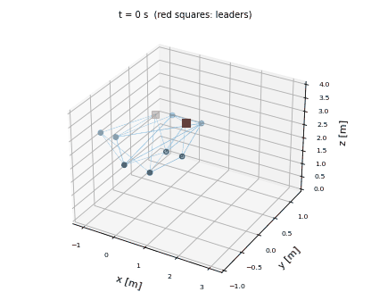
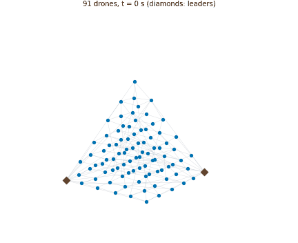
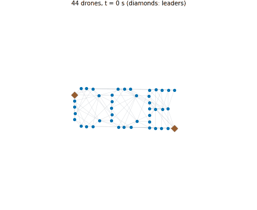

# Bearing-Only Super-Twisting Formation Control: Gazebo Simulation

Gazebo simulation based on the paper *Bearing-Only Super-Twisting Control for Multi-Quadrotor Formations* (CCE 2025). Ten ESP-drones fly in a two-level formation, and the same code also flies [larger formations](#large-formations) of up to 91 drones. Two leaders follow a time-varying velocity that the followers do not know, and the other eight keep their place using only the bearings to their neighbors. The followers can use the Super-Twisting law of the paper (`sta`) or the baseline proportional-derivative law (`pd`).



This repository is based on the simulation of the paper, but it uses another drone and other code. See [Differences from the paper](#differences-from-the-paper).

## What you need

- A computer with **Ubuntu 24.04**.
- About 5 GB of free disk space. No special GPU is needed, because the drones have no cameras here.

You do not need to know ROS or Python to run it, and ROS is not used. Copy each block into a terminal (`Ctrl+Alt+T` opens one) and press Enter.

## Installation

**1. Download the repository**

```bash
sudo apt update && sudo apt install -y git
cd ~
git clone https://github.com/juliordzcer/cce2025-bearing-only-sta.git
cd cce2025-bearing-only-sta
```

**2. Install Gazebo and the other dependencies**

This asks for your password and takes a few minutes.

```bash
./install_deps.sh
```

**3. Build the drone plugins**

```bash
cmake -S . -B build
cmake --build build -j4
```

It should end with `Built target` lines and no errors.

## Running the simulation

From the repository folder, choose a controller:

```bash
python3 scripts/fly_formation.py --controller sta
```

Gazebo and the control panel open after a few seconds. In the Gazebo window, press the view button or scroll to find the drones. Then:

1. Press **Take Off** and wait until all the drones hover at the same height, about 11 s.
2. Press **Automatic Mode**. The formation starts to take shape and move, and the panel shows the bearing error.
3. Press **Land** to finish.

**Emergency Stop** turns the motors off, so the drones fall. Close the panel window to end the simulation.

### Options

| Option | What it does |
|---|---|
| `--controller` | `sta` or `pd` |
| `--formation` | `paper`, `pyramid` or `letters`. See [Large formations](#large-formations) |
| `--scale` | Size of the `paper` formation, and the speed of the leaders. `1.0` is the size of the paper, and the default is `0.5` |
| `--levels` | Layers of the pyramid: 3, 4, 5 and 6 give 14, 30, 55 and 91 drones |
| `--text` | Letters to form, from A to Z |
| `--spacing` | Distance between neighbors in a pyramid or letters, 1.6 m by default |
| `--headless` | Run Gazebo without its window |
| `--auto` | Fly without the panel: take off, fly, save the data and exit |
| `--duration` | Seconds of automatic mode with `--auto` |
| `--output` | Folder for the flight data with `--auto` |

## Reproducing the results

```bash
python3 scripts/fly_formation.py --controller sta --auto --headless --output results
python3 scripts/fly_formation.py --controller pd --auto --headless --output results
```

Each one takes about 75 s, prints the minimum, median and maximum of the bearing error, and saves the flight as a CSV.

## Results

The metric is the one in the paper, measured after the first 30 s of automatic mode. Values are from 4 flights of each controller at scale 0.5, and the flights of a controller differ by less than 0.0002.

| Controller | Minimum | Median | Maximum | Smallest distance between drones [m] |
|---|---|---|---|---|
| PD | 0.0032 | 0.0143 | 0.0220 | 0.39 |
| STA | 0.0053 | 0.0078 | 0.0146 | 0.41 |

STA has the lower median and maximum error, as in the paper, where the medians are 0.0036 for STA and 0.0081 for PD. The values are not the same, because this is another drone and scale, and the velocity loop of the firmware is between these laws and the motors.

## Large formations

The same bearing-only laws also fly much larger formations.




```bash
python3 scripts/fly_formation.py --controller sta --formation pyramid --levels 4
python3 scripts/fly_formation.py --controller sta --formation letters --text CCE
```

There are still two leaders, the two drones farthest apart, and the sensing graph is generated: each drone sees its nearest neighbors, and short edges are added until the bearings and the leaders fix every follower, with the smallest eigenvalue of the follower bearing Laplacian at 0.06 or more. Each drone sees about 4 to 7 neighbors on average.

Large formations start close to their shape, within 10 cm in each axis, so these flights show that the shape is held while moving and not that it forms from far away. The drones first climb straight up to 2.5 m and then go to their place at the same time, on straight lines chosen so that they stay apart. The landing does the same in reverse.

The values use the metric of the paper after the first 30 s, in flights of 60 s without wind. STA uses other gains here than in the formation of the paper, tuned on the pyramid of 30 drones and the letters. The values are the mean of 2 flights of each controller.

| Formation | Drones | PD median | STA median | Smallest distance, PD [m] | Smallest distance, STA [m] |
|---|---|---|---|---|---|
| Pyramid, 3 levels | 14 | 0.0189 | 0.0066 | 1.35 | 1.42 |
| Pyramid, 4 levels | 30 | 0.0342 | 0.0117 | 0.94 | 1.14 |
| Letters CCE | 44 | 0.0267 | 0.0194 | 1.32 | 0.57 |
| Pyramid, 5 levels | 55 | 0.0306 | 0.0216 | 0.90 | 1.01 |
| Pyramid, 6 levels | 91 | 0.0306 | 0.0283 | 0.83 | 1.03 |

STA has the lower error in all of them, and the difference is smallest with 91 drones.

**How long it takes.** Gazebo slows down with more drones, measured without flying: 0.76× real time with 25 drones, 0.40× with 50 and 0.20× with 100, on an Intel i7-14650HX. Everything runs on the simulated clock, so slower does not change the flight, only how long you wait. Use `--headless` with many drones, because the Gazebo window was not tested with them.

**Spacing.** The laws scale with the inverse of the distance. In one flight each with the pyramid of 30 drones and the letters at 0.8 m, STA stayed at a median of 0.015 and 0.018, and PD rose to 0.159 and 0.154, so use 1.6 m with PD.

## Differences from the paper

| | Paper | This repository |
|---|---|---|
| Drone | Parrot Bebop 2 | ESP-drone model, much smaller |
| Formation and speeds | As in the paper | Multiplied by 0.5 by default |
| Measurement | Bearings from the simulated poses | The same |
| Low-level control | Velocity interface of the model | Position, velocity and attitude loops of the drone firmware |
| Bearing rate | From the simulated velocities | From the poses, numerically differentiated and filtered |
| Sign in the STA law | Exact sign | Smooth sign, because the exact one makes a limit cycle of about 1.2 Hz with the velocity loop of the firmware |
| Gains | Table of the paper | Tuned in flight for this drone and scale |
| Simulator | Gazebo Ionic and ROS Rolling | Gazebo Harmonic, without ROS |

## TODO

- Add the Parrot Bebop 2 version, to compare directly with the paper.

## Known limitations

- **Flights at the same time.** Simulations on one computer interfere with each other, and drones can stay on the ground. To run several at once, give each its own `GZ_PARTITION`, `GZ_DISCOVERY_MSG_PORT` and `GZ_DISCOVERY_SRV_PORT`.
- **Windows.** The panel was tested on a virtual display, and flights were tested with Gazebo in headless mode.

## Common problems

**`Gazebo did not start. Check that the plugins were built.`**: run the two commands of step 3 of the installation, from the repository folder.

**`No module named 'gz'`**: run `./install_deps.sh` again.

**The drones stay on the ground**: close everything, check that no earlier simulation is still running with `pgrep -a ruby`, and start again.

## Repository layout

| Folder | Content |
|---|---|
| `plugins` | Motor model, position controller and attitude controller for Gazebo |
| `models/espdrone` | ESP-drone model |
| `worlds` | Gazebo world |
| `scripts` | Bearing-only laws, formations, flight and control panel |

## How to cite

If you use this code, please cite both the paper and this repository.

```bibtex
@inproceedings{lopezruiz2025bearing,
  author    = {López Ruiz, Frida G. and Rodríguez, Julio César and Becerra, Héctor M. and Ruiz León, Javier},
  title     = {Bearing-Only Super-Twisting Control for Multi-Quadrotor Formations},
  booktitle = {2025 22nd International Conference on Electrical Engineering, Computing Science and Automatic Control (CCE)},
  pages     = {1--6},
  year      = {2025},
  url       = {https://ieeexplore.ieee.org/document/11272041}
}
```

```bibtex
@software{rodriguez2026cce2025sim,
  author = {Rodriguez, Julio Cesar},
  title  = {CCE 2025 Bearing-Only Super-Twisting Simulation},
  year   = {2026},
  url    = {https://github.com/juliordzcer/cce2025-bearing-only-sta}
}
```

## License

The code is under the [Apache License 2.0](LICENSE). Keep the [NOTICE](NOTICE) file in copies and derived works.

The ESP-drone model in `models/espdrone` was designed by Julio Cesar Rodriguez, who also measured its parameters on the real drone. It is under the [Creative Commons Attribution 4.0](models/espdrone/LICENSE) license, so credit him if you use or adapt it.

Contact: Julio Cesar Rodriguez, contact@juliordz.com
